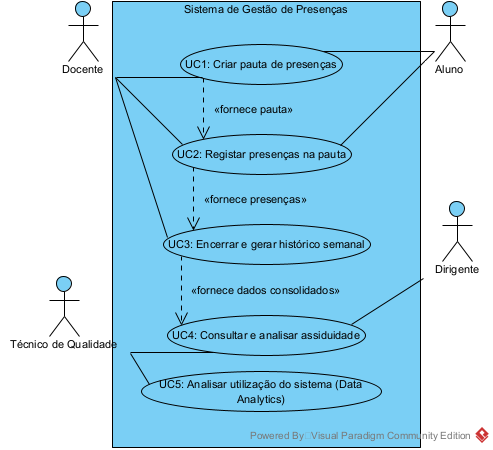

# DAW 2026/2027 — Gestão de Presenças em Contexto Letivo

**Licenciatura em Engenharia Informática · Desenvolvimento de Aplicações Web · UPBeja**  
**Autores:** Beatriz Caixeiro (21198) e Eduardo Madeira (26889)  
**Estado:** Fase 1 — Análise e Desenho documentada; Fase 2 — implementação prevista.

## Objetivo

A solução proposta apoia docentes no planeamento de aulas e registo de presenças, permite encerrar semanas e consultar indicadores de assiduidade, e disponibiliza estatísticas de utilização da plataforma. Os dados académicos de referência são pressupostos como importados; as interfaces e os modelos aqui representados são artefactos de **análise e desenho**, não uma aplicação já implementada.

## Os cinco casos de uso

| UC | Funcionalidade | Atores |
|---|---|---|
| UC1 | Criação da pauta (15 semanas vazias) e planeamento das aulas | Docente |
| UC2 | Registo de presenças, com gravação e validações | Docente |
| UC3 | Encerramento e histórico semanal | Docente |
| UC4 | Consulta e análise da assiduidade | Docente, Técnico e Dirigente |
| UC5 | Análise da utilização da plataforma | Técnico do Gabinete de Qualidade |

A relação entre UC1 → UC2 → UC3 → UC4 é principalmente uma dependência **de dados**; UC5 consulta registos de atividade da aplicação.

## Documentos da fase 1

- [01 — Atores e requisitos](gestao-presencas/docs/fase1/01-atores-requisitos.md)
- [02 — Casos de uso](gestao-presencas/docs/fase1/02-casos-de-uso.md)
- [03 — Modelo de dados](gestao-presencas/docs/fase1/03-base-de-dados.md)
- [04 — Storyboards e wireframes finais (todas as imagens)](gestao-presencas/docs/fase1/04-prototipos.md)
- [05 — Perfis e permissões](gestao-presencas/docs/fase1/05-perfis-permissoes.md)
- [Inventário das imagens com origem e SHA-256](gestao-presencas/prototypes/manifesto-imagens.csv)

## Diagramas finais

[](gestao-presencas/diagrams/casos-de-uso.png)

- [Modelo E/R conceptual](gestao-presencas/diagrams/modelo-er-conceptual.png)
- [Modelo relacional completo](gestao-presencas/diagrams/modelo-relacional-completo.png)
- [Notas sobre fontes editáveis anteriores](gestao-presencas/diagrams/README.md)

## Protótipos finais

- [Storyboards UC1–UC5](gestao-presencas/docs/fase1/04-prototipos.md#storyboards-por-caso-de-uso)
- [Wireframes UC1–UC5](gestao-presencas/docs/fase1/04-prototipos.md#wireframes-finais-por-caso-de-uso)
- [Figma — fonte editável dos wireframes](https://www.figma.com/design/Xf0du0j4eXayTwgKas7hOE/DAW-2026%E2%80%932027-%C2%B7-Gest%C3%A3o-de-Presen%C3%A7as-%E2%80%94-Wireframes-e-Storyboards)

O pacote de imagens finais recebido em **05/11/2026** inclui 3 diagramas, 5 storyboards e 25 wireframes. **Não inclui** exportações independentes da Homepage nem do storyboard geral.

## Organização

```text
DAW-2627/
├── README.md
├── .gitignore
├── COMMITES-E-SUBMISSAO.md
└── gestao-presencas/
    ├── docs/fase1/
    │   ├── 01-atores-requisitos.md
    │   ├── 02-casos-de-uso.md
    │   ├── 03-base-de-dados.md
    │   ├── 04-prototipos.md
    │   └── 05-perfis-permissoes.md
    ├── diagrams/            # PNG finais + fontes existentes
    ├── prototypes/          # storyboards/, wireframes/UC1–UC5
    └── report/README.md
```

## Fase seguinte

Implementação prevista: **Laravel (PHP), MVC/Blade, API REST e MySQL**, seguida de integração e testes funcionais. As permissões de Docente, Técnico e Dirigente são modeladas através das tabelas `utilizador` e `perfil`, não de tabelas específicas por profissão.
