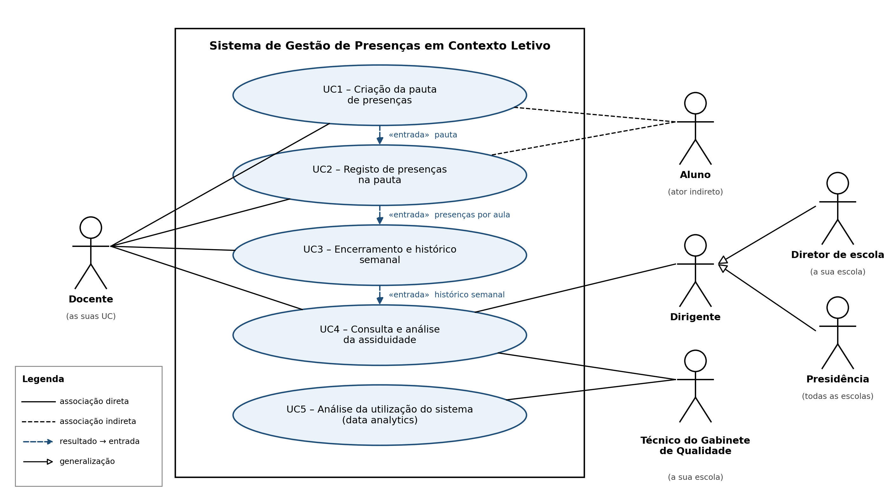

# Cartão 1.2 — Diagrama de Casos de Uso e Especificações UML

**Projeto:** Ferramenta de Gestão de Presenças em Contexto Letivo  
**Unidade curricular:** Desenvolvimento de Aplicações Web  
**Fase:** Análise e Desenho  
**Estado:** Revisto (v0.2) e validado

---

## 1. Objetivo

Este documento especifica os cinco casos de uso do sistema de Gestão de Presenças em Contexto Letivo: quatro do domínio do problema (UC1 a UC4) e um de *data analytics* (UC5). As especificações integram as regras de negócio (RN) e os requisitos não funcionais (RNF) definidos no Cartão 1.1.

## 2. Diagrama de casos de uso (UML)

O diagrama ilustra as interações entre os atores (Docente, Técnico do Gabinete de Qualidade, Dirigente e Aluno) e o sistema, e o encadeamento funcional em que o resultado de cada caso de uso é a entrada do seguinte.

**Nota:** o diagrama deve refletir as alterações da versão 2: o Docente participa também no UC4 e o Dirigente abrange o diretor de escola e o membro da Presidência.

### 2.1. Encadeamento dos casos de uso

| UC | Designação | Ator principal | Entrada | Resultado |
|---|---|---|---|---|
| UC1 | Criação da pauta de presenças | Docente | UC, turma, ano letivo e alunos inscritos | Pauta com alunos e aulas |
| UC2 | Registo de presenças na pauta | Docente | Pauta criada no UC1 | Presenças por aula |
| UC3 | Encerramento e histórico semanal | Docente | Presenças registadas no UC2 | Histórico semanal de assiduidade |
| UC4 | Consulta e análise da assiduidade | Docente, Técnico do Gabinete de Qualidade e Dirigente | Históricos semanais do UC3 | Indicadores numéricos e gráficos |
| UC5 | Análise da utilização do sistema (*data analytics*) | Técnico do Gabinete de Qualidade | Registos de atividade dos utilizadores | Estatísticas e painel de controlo |

## 3. Especificação detalhada dos casos de uso

### UC1: Criação da pauta de presenças

| Campo | Especificação |
| :---- | :---- |
| **Identificador e nome** | **UC1** — Criação da pauta de presenças |
| **Atores** | Principal: Docente. Indireto: Aluno (incluído na pauta através dos dados de inscrição). |
| **Descrição** | O docente configura a estrutura de assiduidade de uma UC pela qual é responsável, definindo a turma, o ano letivo e as aulas das 15 semanas letivas com as respetivas salas, e obtém a pauta com os alunos inscritos. |
| **Requisitos associados** | RN01, RN02, RN07, RNF03, RNF06, RNF08, RNF13 |
| **Pré-condições** | 1. O docente tem sessão ativa e não expirada. 2. O docente tem UC atribuídas. 3. Os dados mestre (escolas, cursos, UC, turmas, salas, alunos e inscrições) estão carregados no sistema. |
| **Pós-condições** | É criada uma pauta associada à UC, à turma e ao ano letivo, com 15 semanas, as respetivas aulas e a lista de alunos inscritos. A pauta serve de entrada ao UC2. |
| **Fluxo principal** | 1. O docente acede a "Gestão de Pautas" e seleciona "Criar nova". 2. O sistema apresenta as UC atribuídas ao docente. 3. O docente seleciona a UC, o ano letivo e a turma; o sistema apresenta automaticamente o ano curricular da UC. 4. O sistema apresenta um formulário para planear as 15 semanas letivas. 5. Para cada semana, o docente define as aulas (data, hora de início e fim, tipo e sala). 6. O sistema valida que não há conflitos de sala nem sobreposição de horários. 7. O docente seleciona "Gerar pauta". 8. O sistema importa os alunos inscritos, cria a pauta e apresenta uma mensagem de sucesso. |
| **Fluxos alternativos e exceções** | **3a. Já existe pauta para a turma escolhida:** o sistema impede a criação e oferece um atalho para a pauta existente. **3b. A turma não tem alunos inscritos:** o sistema informa o docente e não permite gerar a pauta. **6a. A sala já está ocupada no mesmo horário:** o sistema assinala o conflito e pede ao docente que escolha outra sala ou outro horário. **8a. A sessão expira antes de gerar a pauta:** o sistema pede nova autenticação e preserva os dados já preenchidos no formulário. |

---

### UC2: Registo de presenças na pauta

| Campo | Especificação |
| :---- | :---- |
| **Identificador e nome** | **UC2** — Registo de presenças na pauta |
| **Atores** | Principal: Docente. Indireto: Aluno (a sua situação é registada pelo docente). |
| **Descrição** | Em cada aula, o docente abre a pauta e regista a situação de cada aluno (presente, ausente ou falta justificada) numa interface simples, responsiva e compatível com os navegadores modernos. Os registos podem ser corrigidos enquanto a semana estiver aberta. |
| **Requisitos associados** | RN03, RN05, RNF01, RNF02, RNF05, RNF07, RNF08, RNF09 |
| **Pré-condições** | 1. O docente tem sessão ativa e é responsável pela UC da pauta. 2. A pauta foi criada no UC1. 3. A semana da aula está no estado "Aberta". |
| **Pós-condições** | A situação de cada aluno em cada aula fica guardada, pronta a ser consolidada no UC3. |
| **Fluxo principal** | 1. O docente abre uma pauta. 2. Seleciona a semana letiva e a aula. 3. O sistema apresenta a lista de alunos numa grelha adaptada a ecrãs pequenos, com a situação já registada (se existir). 4. O docente define a situação de cada aluno. 5. O docente seleciona "Guardar registos". 6. O sistema grava os registos e apresenta uma confirmação visual. |
| **Fluxos alternativos e exceções** | **2a. A semana está encerrada:** a grelha é apresentada apenas em modo de leitura e a API rejeita qualquer gravação (RN05). **4a. O docente corrige um registo já guardado:** o sistema atualiza a situação do aluno, desde que a semana continue aberta. **4b. A aula ainda não ocorreu (data futura):** o sistema não permite registar presenças e informa o docente. **6a. A sessão expira antes de guardar:** o sistema pede nova autenticação e preserva os registos preenchidos, evitando a sua perda (RNF09). **6b. Falha de comunicação com a API:** o sistema informa o docente de que os registos não foram guardados e permite tentar novamente. |

---

### UC3: Encerramento e criação do histórico semanal

| Campo | Especificação |
| :---- | :---- |
| **Identificador e nome** | **UC3** — Encerramento e criação do histórico semanal |
| **Atores** | Principal: Docente. |
| **Descrição** | No final de cada semana, o docente revê os registos e encerra a semana. A operação é irreversível e gera o histórico semanal com o número de presenças, de faltas e de faltas justificadas e a taxa de frequência da UC (RN04). |
| **Requisitos associados** | RN04, RN05, RNF03, RNF05, RNF09, RNF13 |
| **Pré-condições** | 1. O docente tem sessão ativa e é responsável pela UC da pauta. 2. A semana está no estado "Aberta". 3. Todas as aulas da semana têm situação registada para todos os alunos (UC2). |
| **Pós-condições** | 1. A semana passa irreversivelmente ao estado "Encerrada" e os seus registos ficam bloqueados. 2. É gerado o histórico semanal, que serve de entrada ao UC4. 3. O encerramento fica registado (utilizador, data e hora). |
| **Fluxo principal** | 1. O docente abre a pauta e seleciona "Encerrar semana". 2. O sistema apresenta um resumo com os totais de presenças, ausências, faltas justificadas e a taxa de frequência. 3. O sistema avisa que o encerramento é definitivo e pede a reintrodução da palavra-passe. 4. O docente confirma o encerramento e introduz a palavra-passe. 5. O sistema valida a palavra-passe, encerra a semana, grava o histórico numa única transação e apresenta uma mensagem de sucesso. |
| **Fluxos alternativos e exceções** | **1a. Existem aulas ou alunos sem situação registada:** o sistema lista as lacunas e não permite o encerramento até estarem preenchidas (RN05). **2a. O docente deteta incoerências no resumo:** cancela a operação, a semana mantém-se aberta e regressa ao UC2 para corrigir. **4a. A palavra-passe está incorreta:** o sistema recusa o encerramento e regista a tentativa falhada. **5a. Falha durante a gravação:** a transação é anulada, a semana mantém-se aberta e o docente é informado. |

---

### UC4: Consulta e análise da assiduidade

| Campo | Especificação |
| :---- | :---- |
| **Identificador e nome** | **UC4** — Consulta e análise da assiduidade |
| **Atores** | Principais: Docente (limitado às suas UC), Técnico do Gabinete de Qualidade (limitado à sua escola) e Dirigente (diretor de escola: a sua escola; Presidência: todas as escolas). |
| **Descrição** | O utilizador consulta os históricos semanais em tabelas e gráficos, com filtros por escola (apenas Presidência), curso, UC, ano curricular e ano letivo. Permite analisar a evolução da taxa de frequência ao longo das 15 semanas, comparar UC e relacionar a assiduidade com o sucesso académico (RN08). |
| **Requisitos associados** | RN04, RN06, RN08, RNF01, RNF04, RNF06, RNF08, RNF10, RNF13 |
| **Pré-condições** | 1. O utilizador tem sessão ativa. 2. Existem históricos semanais gerados (UC3) dentro do âmbito do utilizador. |
| **Pós-condições** | Os indicadores ficam apresentados em formato numérico e gráfico, dentro do âmbito de acesso do utilizador. |
| **Fluxo principal** | 1. O utilizador acede a "Indicadores de Assiduidade". 2. O sistema determina o âmbito de acesso a partir do perfil e dos dados da sessão (RN06). 3. O utilizador define os filtros disponíveis dentro desse âmbito. 4. O sistema consulta a API e apresenta tabelas numéricas e gráficos, incluindo a evolução semanal da taxa de frequência e a comparação entre UC. 5. O utilizador pode comparar a taxa de frequência com o resultado final dos alunos (aprovação ou nota). |
| **Fluxos alternativos e exceções** | **3a. Os filtros não produzem resultados:** o sistema apresenta uma mensagem informativa e sugere alterar os filtros. **3b. O utilizador tenta aceder, por URL ou pela API, a dados fora do seu âmbito:** o servidor recusa o pedido com erro HTTP 403 e regista a tentativa (RNF04 e RNF13). **4a. Falha na obtenção dos dados:** o sistema informa que os indicadores não estão disponíveis e permite tentar novamente. |

---

### UC5: Análise da utilização do sistema (*data analytics*)

| Campo | Especificação |
| :---- | :---- |
| **Identificador e nome** | **UC5** — Análise da utilização do sistema (*data analytics*) |
| **Atores** | Principal: Técnico do Gabinete de Qualidade. |
| **Descrição** | O sistema recolhe automaticamente dados de atividade dos utilizadores e o técnico analisa-os num painel de controlo: páginas visualizadas, duração das visitas, utilizadores ativos por perfil e período e funcionalidades mais utilizadas. Os dados limitam-se à escola do técnico. |
| **Requisitos associados** | RN06, RNF03, RNF04, RNF08, RNF11 |
| **Pré-condições** | 1. O técnico tem sessão ativa. 2. O sistema já recolheu registos de atividade (fluxo automático descrito abaixo). |
| **Pós-condições** | O painel de controlo apresenta as estatísticas de utilização atualizadas da escola do técnico. |
| **Fluxo automático de recolha** | Em cada pedido de um utilizador autenticado, o sistema regista o utilizador (de que decorrem o perfil e a escola), a página, a funcionalidade acedida, a data e hora de início e a duração da visita (RNF11). |
| **Fluxo principal** | 1. O técnico acede a "Data Analytics — Utilização do Sistema". 2. Seleciona o período de análise (por exemplo, dia, semana ou mês). 3. O sistema filtra os registos de atividade pela escola do técnico (RN06). 4. O sistema apresenta as páginas mais visualizadas, a duração média das visitas, o número de utilizadores ativos por perfil e as funcionalidades mais utilizadas, em tabelas e gráficos. |
| **Fluxos alternativos e exceções** | **3a. Não existem registos no período selecionado:** o sistema apresenta uma mensagem informativa. **4a. Falha na obtenção dos registos de atividade:** o sistema informa que as métricas não estão disponíveis e regista a falha. |
