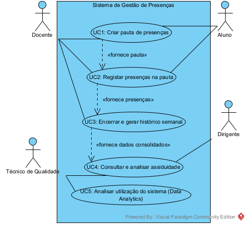

# Cartão 1.2 - Diagrama de Casos de Uso e Especificações UML

**Projeto:** Ferramenta de Gestão de Presenças em Contexto Letivo  
**Unidade curricular:** Desenvolvimento de Aplicações Web  
**Fase:** Análise e Desenho  
**Estado:** Rascunho para revisão do grupo

---

## 1. Objetivo

Este documento detalha as especificações dos cinco casos de uso do sistema de Gestão de Presenças em Contexto Letivo, integrando as regras de negócio, o encadeamento de fluxos e as restrições rigorosas de acesso, segurança e desempenho definidas nos requisitos não funcionais (RNF).

## 1\. Diagrama de Casos de Uso (UML)

O diagrama abaixo ilustra as interações entre os atores (Docente, Técnico de Qualidade, Dirigente e Aluno) e o sistema, demonstrando o encadeamento funcional exigido, em que a saída de um processo serve de entrada para o seguinte.

---

## 2\. Especificação Detalhada dos Casos de Uso

As tabelas seguintes descrevem o comportamento do sistema para cada funcionalidade, refletindo o bloqueio absoluto de semanas, a limitação de filtros por escola e as validações de sessão e desempenho.

### UC1: Criação da Pauta de Presenças

| Campo | Especificação |
| :---- | :---- |
| **Identificador e Nome** | **UC1** — Criação da pauta de presenças |
| **Ator Principal** | Docente |
| **Atores Secundários** | Aluno (participação indireta via importação de dados de inscrição) |
| **Descrição** | O docente configura a estrutura de assiduidade de uma unidade curricular pela qual é responsável, definindo o ano letivo, alocando salas para as 15 semanas e importando os alunos inscritos. |
| **Pré-condições** | 1\. O utilizador possui uma sessão ativa e não expirada com o perfil de Docente (RNF03). 2\. O Docente tem de ter unidades curriculares (UC) atribuídas ao seu perfil. 3\. O sistema já possui a informação base carregada na base de dados (Cursos, Escolas, UCs, Salas, Alunos). |
| **Pós-condições** | O sistema cria um registo de pauta estruturado com 15 semanas letivas, associado à respetiva UC, ano letivo e lista de alunos, servindo de estrutura base para o **UC2**. |
| **Fluxo Principal** | 1\. O Docente acede à secção "Gestão de Pautas" e seleciona "Criar Nova". 2\. O Sistema apresenta a lista de UCs associadas ao Docente. 3\. O Docente seleciona a UC desejada e indica o Ano Letivo e Ano Curricular. 4\. O Sistema gera um formulário interativo para a planificação das 15 semanas letivas. 5\. O Docente associa as salas físicas disponíveis a cada uma das aulas previstas. 6\. O Docente clica em "Gerar Pauta". 7\. A API valida a operação em menos de 500ms (RNF08), importa os alunos inscritos, cria a pauta e apresenta uma mensagem de sucesso. |
| **Fluxos Alternativos / Exceções** | **3a. Já existe uma pauta criada para a UC no ano letivo selecionado:** 3a.1. O Sistema emite um erro de duplicação e impede a criação, fornecendo um atalho para a pauta existente. |

---

### UC2: Registo de Presenças na Pauta

| Campo | Especificação |
| :---- | :---- |
| **Identificador e Nome** | **UC2** — Registo de presenças na pauta |
| **Ator Principal** | Docente |
| **Descrição** | Durante ou após a aula, o docente acede à grelha da pauta e regista o estado de presença de cada aluno, numa interface simples, responsiva e *cross-browser*. |
| **Pré-condições** | 1\. O Docente possui uma sessão ativa válida (RNF03). 2\. A pauta tem de ter sido previamente estruturada (**resultado do UC1**). 3\. A semana letiva encontra-se com o estado "Aberta". |
| **Pós-condições** | O estado de assiduidade é guardado na base de dados, ficando preparado para consolidação no **UC3**. |
| **Fluxo Principal** | 1\. O Docente acede à vista detalhada de uma pauta. 2\. Seleciona a semana letiva e a aula correspondente. 3\. O Sistema apresenta a lista de alunos numa grelha HTML/CSS compatível com múltiplos navegadores (RNF07) e adaptada a ecrãs pequenos (RNF02). 4\. O Docente preenche a situação de cada aluno (Presente, Ausente, Justificado). 5\. O Docente clica em "Guardar Registos". 6\. A API processa o pedido em menos de 500ms (RNF08) e exibe confirmação visual. |
| **Fluxos Alternativos / Exceções** | **2a. A semana letiva selecionada já se encontra encerrada (Bloqueio Absoluto \- RNF05):** 2a.1. O Sistema aplica a regra de bloqueio irreversível: a grelha é apresentada estritamente em modo de leitura e a API rejeita qualquer tentativa de gravação. |

---

### UC3: Encerramento e Criação do Histórico Semanal

| Campo | Especificação |
| :---- | :---- |
| **Identificador e Nome** | **UC3** — Encerramento e criação do histórico semanal |
| **Ator Principal** | Docente |
| **Descrição** | Funcionalidade crítica onde o docente tranca definitivamente uma semana de aulas. A ação é irreversível (RNF05) e gera os totais de assiduidade. |
| **Pré-condições** | 1\. Existem registos de presenças inseridos nas aulas da respetiva semana (**resultado do UC2**). 2\. A semana letiva encontra-se atualmente no estado "Aberta". |
| **Pós-condições** | 1\. A semana letiva transita irreversivelmente para o estado "Encerrada", aplicando um bloqueio absoluto aos registos. 2\. O histórico consolidado da semana é gerado (**entrada para o UC4**). |
| **Fluxo Principal** | 1\. O Docente acede à pauta e seleciona "Encerrar Semana". 2\. O Sistema exibe um aviso claro (*modal*) indicando que o encerramento é **definitivo e absoluto**, juntamente com os totais de presenças e faltas calculados. 3\. O Docente confirma a exatidão e valida a ação criticamente (podendo ser pedida reinserção de password por segurança \- RNF03). 4\. O Sistema tranca a semana de forma irreversível e grava no histórico, reduzindo o risco de perda de dados (RNF09). |
| **Fluxos Alternativos / Exceções** | **2a. O Docente deteta incoerências no painel de revisão:** 2a.1. Cancela a operação, mantendo a semana aberta, e regressa ao UC2 para corrigir os registos. |

---

### UC4: Consulta e Análise da Assiduidade

| Campo | Especificação |
| :---- | :---- |
| **Identificador e Nome** | **UC4** — Consulta e análise da assiduidade |
| **Atores Principais** | Técnico do Gabinete de Qualidade, Dirigente |
| **Descrição** | Consulta de históricos consolidados através de painéis gráficos, com restrição estrita aos dados da Escola do utilizador autenticado (RNF04). |
| **Pré-condições** | 1\. O utilizador possui uma sessão ativa válida. 2\. Têm de existir históricos semanais gerados no sistema (**resultado do UC3**). |
| **Pós-condições** | Visualização rápida (\< 2 segundos) de métricas de assiduidade na interface web. |
| **Fluxo Principal** | 1\. O utilizador acede ao painel "Indicadores de Assiduidade". 2\. O Sistema identifica a Escola a que o utilizador pertence através dos dados da sessão e **aplica uma restrição fixa limitando os dados a essa mesma escola**. 3\. O utilizador define os filtros permitidos na sua escola (Curso, UC, Anos). 4\. O Sistema interroga a API e renderiza as tabelas numéricas e gráficos em menos de 2 segundos (RNF08). |
| **Fluxos Alternativos / Exceções** | **2a. Utilizador tenta forçar na URL/API a visualização de dados de outra escola:** 2a.1. O backend verifica o perfil e a restrição de escola (RNF04), deteta a quebra de privacidade e devolve um erro HTTP 403 (Forbidden). |

---

### UC5: Análise da Utilização do Sistema (Data Analytics)

| Campo | Especificação |
| :---- | :---- |
| **Identificador e Nome** | **UC5** — Análise da utilização do sistema (Data Analytics) |
| **Ator Principal** | Técnico do Gabinete de Qualidade |
| **Descrição** | Avaliação estatística da utilização da plataforma (telemetria), visualizando métricas de desempenho e navegação dos perfis, também limitadas ao contexto da escola do técnico. |
| **Pré-condições** | 1\. Sessão ativa válida com perfil de Técnico de Qualidade. 2\. O sistema registou dados contínuos de navegação e utilização (páginas visualizadas, duração das visitas) em background (RNF11). |
| **Pós-condições** | Exibição do *dashboard* de telemetria atualizado. |
| **Fluxo Principal** | 1\. O Técnico acede a "Data Analytics \- Utilização do Sistema". 2\. A API filtra automaticamente os *logs* para incluir apenas a atividade permitida para aquele utilizador. 3\. O Sistema renderiza as páginas mais visitadas, durações de sessão e contagem de utilizadores ativos por perfil, garantindo tempos de resposta otimizados (\< 2 segundos). |
| **Fluxos Alternativos / Exceções** | **2a. Ocorre uma falha na obtenção dos logs de telemetria:** 2a.1. O Sistema exibe uma mensagem de erro indicando que as métricas não estão disponíveis e regista a falha de forma segura. |
