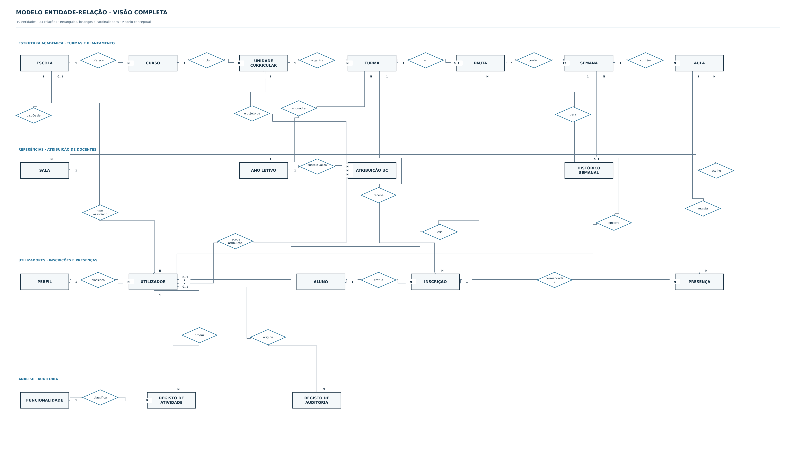
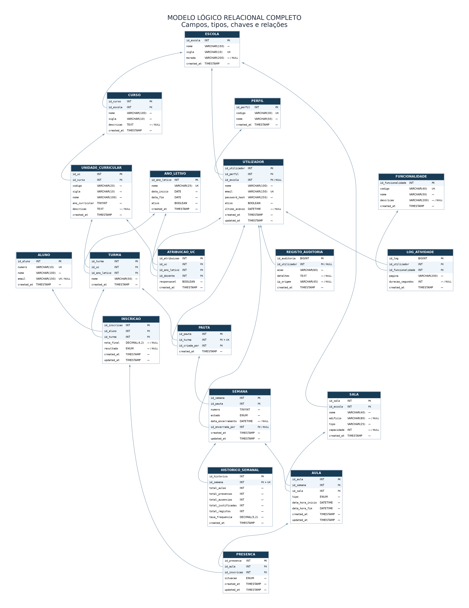
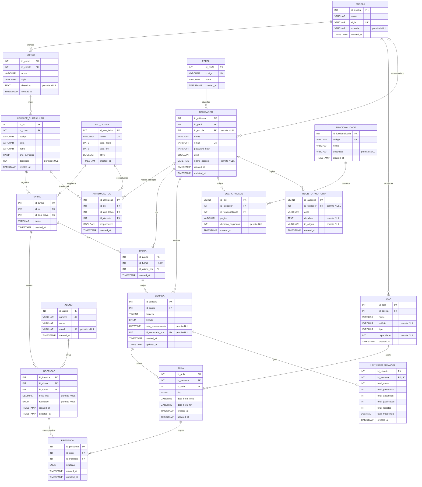

# Cartão 1.3 - Modelação da Base de Dados (E/R e Lógico Relacional)

**Projeto:** Ferramenta de Gestão de Presenças em Contexto Letivo  
**Unidade curricular:** Desenvolvimento de Aplicações Web  
**Fase:** Análise e Desenho  
**Estado:** Modelo de 19 tabelas / 24 relações; imagens finais do E/R e relacional de 05/11/2026

---

## 1. Objetivo

Este documento define a estrutura de dados que suporta os cinco casos de uso (UC1 a UC5), as regras de negócio (RN01 a RN09) e os requisitos (RNF01 a RNF13) dos Cartões 1.1 e 1.2. Contém o diagrama de Entidade-Relação (E/R), o modelo lógico relacional e a validação do modelo face aos filtros do UC4 e às métricas do UC5. A solução será implementada com Laravel e MySQL. Os dados académicos de referência, incluindo escolas, cursos, unidades curriculares, anos letivos, turmas, alunos, inscrições e resultados disponíveis, são carregados por importação; o docente não cria nem altera estes dados. As salas são carregadas previamente e devem ser importadas quando a instituição forneça os respetivos dados.

### 1.1. Importação dos dados académicos

Neste projeto, assume-se que os dados académicos de referência são disponibilizados pela instituição e carregados para as respetivas tabelas através de um processo de importação. O docente não cria, edita nem elimina escolas, cursos, unidades curriculares, anos letivos, turmas, alunos, inscrições ou resultados académicos. As salas são igualmente importadas quando disponibilizadas pela instituição. No UC1, seleciona uma turma já importada e, caso ainda não exista, cria a pauta de presenças associada.

O processo de importação deve validar os campos obrigatórios, os identificadores de origem e as relações entre os registos antes de os gravar. Deve também tratar importações repetidas sem criar duplicados, utilizando códigos oficiais ou outras chaves naturais estáveis fornecidas pela instituição. Os *seeders* Laravel destinam-se a dados técnicos ou de demonstração e não substituem a importação dos dados académicos reais.

A origem e o formato concreto dos ficheiros de importação ainda não estão definidos neste modelo; esta integração é um pressuposto de desenho e não uma integração institucional confirmada. Por isso, não se pressupõe um formato específico (por exemplo, CSV ou Excel).

## 2. Entidades identificadas

| Entidade | Descrição | Origem |
|---|---|---|
| ESCOLA | Escola do politécnico. | Enunciado, RN06 |
| CURSO | Curso pertencente a uma escola. | Enunciado |
| UNIDADE_CURRICULAR | UC de um curso, com o respetivo ano curricular. | Enunciado, RNF06 |
| ANO_LETIVO | Ano letivo. | Enunciado |
| SALA | Sala disponível nos edifícios de uma escola. | Enunciado, UC1 |
| PERFIL | Perfil de acesso: docente, técnico do gabinete de qualidade, diretor de escola ou presidência. | RN06 |
| UTILIZADOR | Pessoa com conta no sistema (docente, técnico ou dirigente). | UC1 a UC5 |
| ATRIBUICAO_UC | Associação entre docentes, unidades curriculares e anos letivos, identificando o docente responsável quando aplicável. | Enunciado, RN06 |
| ALUNO | Aluno. | Cartão 1.1 |
| TURMA | Turma de uma UC num ano letivo, proveniente dos dados académicos importados. | D5, RN01, RN07 |
| INSCRICAO | Inscrição de um aluno numa turma, com o resultado final. | RN07, RN08 |
| PAUTA | Pauta de presenças de uma turma. | UC1, RN01 |
| SEMANA | Uma das 15 semanas letivas de uma pauta, aberta ou encerrada. | UC1, UC3, RN05 |
| AULA | Aula de uma semana, com início, fim, tipo e sala. | RN02 |
| PRESENCA | Situação de um aluno numa aula. | UC2, RN03 |
| HISTORICO_SEMANAL | Totais e taxa de frequência de uma semana encerrada. | UC3, RN04 |
| FUNCIONALIDADE | Funcionalidade da aplicação, utilizada para classificar a atividade. | UC5 |
| LOG_ATIVIDADE | Registo de cada página visitada e respetiva duração. | UC5, RNF11 |
| REGISTO_AUDITORIA | Registo de operações críticas. | RNF13 |

## 3. Diagrama Entidade-Relação (E/R conceptual)



**Ficheiros do diagrama completo:** [SVG ampliável](../../diagrams/modelo-er-conceptual.svg) · [PNG](../../diagrams/modelo-er-conceptual.png) · **[ficheiro Draw.io editável](../../diagrams/modelo-er-conceptual.drawio)**. O Draw.io, com quatro páginas, é a **fonte de referência para o E/R conceptual**: alterações às entidades, relações ou cardinalidades devem ser feitas nesse ficheiro e refletidas nas exportações SVG/PNG. A versão [Graphviz DOT](../../diagrams/modelo-er-conceptual.dot) é uma representação alternativa e não reproduz necessariamente o posicionamento do Draw.io.

O E/R conceptual contém **19 entidades e 24 relações**, desenhados com a notação solicitada pelo docente: **retângulos** para entidades, **losangos** para relações e **cardinalidades** junto às entidades. As entidades associativas `ATRIBUICAO_UC`, `INSCRICAO` e `PRESENCA` aparecem explicitamente para permitir corresponder o E/R ao modelo lógico relacional, sem perder a relação N:M subjacente.

**Legenda:** `1` indica uma ocorrência; `N` indica várias; `0..1` significa no máximo uma, podendo não existir; `15` representa as quinze semanas obrigatórias de cada pauta, garantidas na lógica de criação. As relações com referência opcional (por exemplo, `UTILIZADOR`–`ESCOLA`, `SEMANA`–`UTILIZADOR` e `REGISTO_AUDITORIA`–`UTILIZADOR`) mostram `0..1` do lado da entidade referenciada. As tabelas podem estar vazias antes das importações, pelo que `N` não significa que já existam registos.

O ficheiro Draw.io tem **uma página com o modelo completo** e **três páginas de detalhe**. As páginas de detalhe reutilizam entidades existentes para mostrar as mesmas relações com maior espaço; não representam tabelas adicionais. Os relações em losangos e as cardinalidades são elementos editáveis, não fazem parte de uma imagem fixa.

### 3.1. Vistas do E/R por área funcional

Para a leitura e apresentação, o modelo completo também está repartido em vistas **complementares**. Estas vistas não são modelos independentes nem acrescentam novas entidades ou relações:

| Área | Diagrama | Conteúdo |
|---|---|---|
| Estrutura académica | [Abrir SVG](../../diagrams/er-academica.svg) | Escola, curso, UC, ano letivo, sala, turma, aluno e inscrição |
| Gestão de presenças | [Abrir SVG](../../diagrams/er-gestao_presencas.svg) | Turma, pauta, semana, aula, sala, presença, inscrição, histórico e docente |
| Utilizadores e atividade | [Abrir SVG](../../diagrams/er-utilizadores_atividade.svg) | Perfis, docentes, atribuições, criação/encerramento, utilização e auditoria |

### 3.2. Principais cardinalidades e interpretação

| Relação / dependência | Cardinalidade | Significado e regra associada |
|---|---|---|
| ESCOLA — CURSO / SALA | 1:N | Cada curso e cada sala pertencem a uma escola. |
| ESCOLA — UTILIZADOR | 0..1:N | Um utilizador pode não estar associado a uma escola apenas quando pertence à Presidência (RN06). |
| PERFIL — UTILIZADOR | 1:N | Cada utilizador autenticado tem um perfil de acesso. |
| CURSO — UNIDADE_CURRICULAR | 1:N | Cada UC pertence a um curso e tem um ano curricular. |
| UNIDADE_CURRICULAR — TURMA | 1:N | Cada turma é de uma UC importada. |
| ANO_LETIVO — TURMA | 1:N | Cada turma está associada a um ano letivo. |
| UC + ANO_LETIVO + UTILIZADOR — ATRIBUICAO_UC | Três associações 1:N | Associação contextualizada que permite **vários docentes por UC/ano letivo**, com no máximo um responsável assinalado (RN09). |
| ALUNO — INSCRICAO — TURMA | Duas associações 1:N | Representa a inscrição de alunos nas turmas (relação conceptual N:M). |
| TURMA — PAUTA | 1:0..1 | A turma importada pode ainda não ter pauta, mas nunca tem duas (RN01). |
| UTILIZADOR — PAUTA | 1:N | O criador da pauta é um docente autorizado para essa UC e esse ano letivo. |
| PAUTA — SEMANA | 1:15 | A geração de pauta cria as quinze semanas do período letivo (RN02). |
| SEMANA — AULA | 1:0..N | As semanas são criadas inicialmente sem aulas e podem receber várias aulas posteriormente. |
| SALA — AULA | 1:N | A mesma sala pode acolher várias aulas, sem sobreposição de horários. |
| AULA — PRESENCA — INSCRICAO | Duas associações 1:N | Cada presença associa uma aula a uma inscrição. Uma aula inclui várias inscrições e uma inscrição participa em várias aulas, mas cada par aula–inscrição só pode ter um registo. |
| SEMANA — HISTORICO_SEMANAL | 1:0..1 | O histórico só existe depois do encerramento e não pode duplicar-se (RN05). |
| UTILIZADOR — SEMANA | 0..1:N | Enquanto aberta, a semana não tem docente que a tenha encerrado. |
| UTILIZADOR — LOG_ATIVIDADE | 1:N | Cada visita autenticada tem um utilizador associado (UC5). |
| FUNCIONALIDADE — LOG_ATIVIDADE | 1:N | A atividade é classificada por funcionalidade. |
| UTILIZADOR — REGISTO_AUDITORIA | 0..1:N | Algumas ocorrências, como tentativas de autenticação de conta desconhecida, não têm utilizador conhecido. |

**Importante:** um diagrama E/R representa associações e cardinalidades, mas não implementa por si só regras como a existência de quinze semanas, a completude das presenças, a não sobreposição de horários ou a validação dos perfis dos docentes. Essas condições constam das regras de negócio e serão implementadas no servidor/API e nas migrações MySQL, sempre que possível.

### 3.3. Manutenção do modelo no Draw.io

Para editar o E/R, abrir o ficheiro [`modelo-er-conceptual.drawio`](../../diagrams/modelo-er-conceptual.drawio) em [diagrams.net](https://app.diagrams.net/). A **primeira página** contém as 19 entidades e os 24 relações do modelo completo; as **três páginas seguintes** são vistas de leitura da estrutura académica, gestão de presenças e utilizadores/atividade. Nessas páginas, uma entidade pode surgir novamente por razões de legibilidade: trata-se da mesma entidade do modelo completo.

Após qualquer alteração, exportar novamente a página completa para `modelo-er-conceptual.svg` e `modelo-er-conceptual.png`, mantendo os nomes indicados. Se a alteração tiver consequências no esquema, atualizar **também** o Mermaid da secção 4.1, o dicionário da secção 4.2, as restrições e os documentos de requisitos/casos de uso afetados. As páginas de detalhe são auxiliares: a presença de uma ligação numa vista parcial não significa que exista uma relação adicional na base de dados.

## 4. Modelo lógico relacional

### 4.1. Modelo lógico relacional — tabelas, atributos e chaves

O modelo lógico relacional contém as mesmas **19 tabelas** e as **24 ligações por chave estrangeira** do E/R, agora com os atributos, os tipos MySQL, as chaves primárias, as chaves estrangeiras e as chaves únicas simples. As associações N:M são implementadas pelas tabelas `atribuicao_uc`, `inscricao` e `presenca`.

**Diagrama relacional completo:** [SVG ampliável](../../diagrams/modelo-relacional-completo.svg) · [PNG](../../diagrams/modelo-relacional-completo.png) · **[código Mermaid editável](../../diagrams/modelo-relacional-completo.mmd)** · [fonte Graphviz DOT](../../diagrams/modelo-relacional-completo.dot). O Mermaid descreve o **esquema e as cardinalidades**; a disposição das caixas é produzida automaticamente. Para uma consulta rápida, utilizam-se as vistas funcionais da secção 4.1.1.



A versão seguinte em Mermaid faz parte do próprio documento Markdown e pode ser editada ou visualizada em plataformas compatíveis:



**Legenda:** `PK` = chave primária; `FK` = chave estrangeira; `UK` = unicidade simples; `permite NULL` = campo opcional. No diagrama SVG/PNG, `FK + UK` identifica uma FK única. Uma FK composta não é representada como uma única linha: os índices únicos sobre várias colunas estão especificados abaixo. Os campos `created_at` e `updated_at` conservam estes nomes técnicos por seguirem a convenção Eloquent do Laravel.

#### 4.1.1. Vistas físicas complementares

Para evitar uma figura demasiado densa durante a defesa, disponibilizam-se também três vistas do mesmo modelo. Algumas tabelas surgem em mais do que uma vista por serem necessárias às ligações entre áreas; **não são duplicadas na base de dados**.

| Vista | SVG | Mermaid |
|---|---|---|
| Estrutura académica | [Ver diagrama](../../diagrams/relacional-academica.svg) | [Abrir código](../../diagrams/relacional-academica.mmd) |
| Gestão de presenças | [Ver diagrama](../../diagrams/relacional-gestao_presencas.svg) | [Abrir código](../../diagrams/relacional-gestao_presencas.mmd) |
| Utilizadores e atividade | [Ver diagrama](../../diagrams/relacional-utilizadores_atividade.svg) | [Abrir código](../../diagrams/relacional-utilizadores_atividade.mmd) |

#### 4.1.2. Restrições de unicidade importantes

O Mermaid não descreve integralmente as chaves únicas **compostas**; estas devem ser criadas em migrações Laravel e encontram-se no dicionário de dados e nas regras de integridade:

| Tabela | Restrição |
|---|---|
| `curso` | `UNIQUE (id_escola, sigla)` |
| `unidade_curricular` | `UNIQUE (id_curso, codigo)` |
| `sala` | `UNIQUE (id_escola, nome)` |
| `atribuicao_uc` | `UNIQUE (id_uc, id_ano_letivo, id_docente)` |
| `turma` | `UNIQUE (id_uc, id_ano_letivo, nome)` |
| `inscricao` | `UNIQUE (id_aluno, id_turma)` |
| `semana` | `UNIQUE (id_pauta, numero)` |
| `aula` | `UNIQUE (id_sala, data_hora_inicio)` — não substitui a verificação de sobreposição de intervalos |
| `presenca` | `UNIQUE (id_aula, id_inscricao)` |

Existem ainda chaves únicas **simples** essenciais em `pauta.id_turma` (uma pauta por turma) e `historico_semanal.id_semana` (um histórico por semana), além dos códigos e identificadores assinalados como `UK` no Mermaid. A existência de vários docentes por UC/ano letivo é compatível com `UNIQUE (id_uc, id_ano_letivo, id_docente)`; a regra do máximo de um responsável por UC/ano é uma validação adicional (RN09).

#### 4.1.3. Esquema relacional em notação compacta

Notação: **chave primária** a negrito; `#` indica chave estrangeira. As colunas `created_at` e, quando aplicável, `updated_at` estão incluídas, conforme o dicionário de dados.

- perfil(**id_perfil**, codigo, nome, created_at)
- escola(**id_escola**, nome, sigla, morada, created_at)
- curso(**id_curso**, #id_escola, nome, sigla, descricao, created_at)
- unidade_curricular(**id_uc**, #id_curso, codigo, sigla, nome, ano_curricular, descricao, created_at)
- ano_letivo(**id_ano_letivo**, nome, data_inicio, data_fim, ativo, created_at)
- sala(**id_sala**, #id_escola, nome, edificio, tipo, capacidade, created_at)
- utilizador(**id_utilizador**, #id_perfil, #id_escola, nome, email, password_hash, ativo, ultimo_acesso, created_at, updated_at)
- atribuicao_uc(**id_atribuicao**, #id_uc, #id_ano_letivo, #id_docente, responsavel, created_at)
- aluno(**id_aluno**, numero, nome, email, created_at)
- turma(**id_turma**, #id_uc, #id_ano_letivo, nome, created_at)
- inscricao(**id_inscricao**, #id_aluno, #id_turma, nota_final, resultado, created_at, updated_at)
- pauta(**id_pauta**, #id_turma, #id_criada_por, created_at)
- semana(**id_semana**, #id_pauta, numero, estado, data_encerramento, #id_encerrada_por, created_at, updated_at)
- aula(**id_aula**, #id_semana, #id_sala, tipo, data_hora_inicio, data_hora_fim, created_at, updated_at)
- presenca(**id_presenca**, #id_aula, #id_inscricao, situacao, created_at, updated_at)
- historico_semanal(**id_historico**, #id_semana, total_aulas, total_presencas, total_ausencias, total_justificadas, total_registos, taxa_frequencia, created_at)
- funcionalidade(**id_funcionalidade**, codigo, nome, descricao, created_at)
- log_atividade(**id_log**, #id_utilizador, #id_funcionalidade, pagina, duracao_segundos, created_at)
- registo_auditoria(**id_auditoria**, #id_utilizador, acao, detalhes, ip_origem, created_at)

### 4.2. Dicionário de dados

Tipos orientados para MySQL. Em «Restrições»: PK = chave primária (auto-incremento), FK = chave estrangeira, UK = valor único, NN = não nulo. O símbolo `—` indica **ausência de restrição explicitada nesta coluna**; a nulabilidade deve ser lida a partir da definição SQL/migração e das regras de negócio. Para os campos com `—` nesta proposta, admite-se `NULL`, salvo indicação contrária a validar.

**Convenção de tempo:** todas as tabelas têm `created_at` (TIMESTAMP, NN, por omissão a data e hora atuais), que não é repetido nas tabelas abaixo. As tabelas editáveis (`utilizador`, `inscricao`, `semana`, `aula` e `presenca`) têm também `updated_at` (TIMESTAMP, NN, atualizado a cada alteração). As tabelas `historico_semanal`, `log_atividade` e `registo_auditoria` são apenas de inserção e não têm `updated_at`.

#### perfil

| Atributo | Tipo | Restrições | Explicação |
|---|---|---|---|
| id_perfil | INT | PK | Identificador do perfil. |
| codigo | VARCHAR(30) | NN, UK | Identificador estável utilizado no código: docente, tecnico_qualidade, diretor_escola, presidencia. |
| nome | VARCHAR(50) | NN | Nome apresentado: Docente, Técnico do Gabinete de Qualidade, Diretor de escola, Presidência. |

#### escola

| Atributo | Tipo | Restrições | Explicação |
|---|---|---|---|
| id_escola | INT | PK | Identificador da escola. |
| nome | VARCHAR(150) | NN | Nome da escola. |
| sigla | VARCHAR(10) | NN, UK | Sigla (por exemplo, ESTG), utilizada nos ecrãs e nos filtros. |
| morada | VARCHAR(200) | — | Morada da escola. |

#### curso

| Atributo | Tipo | Restrições | Explicação |
|---|---|---|---|
| id_curso | INT | PK | Identificador do curso. |
| id_escola | INT | FK → escola, NN | Escola a que o curso pertence. |
| nome | VARCHAR(100) | NN | Nome do curso. |
| sigla | VARCHAR(10) | NN | Sigla do curso (por exemplo, LEI); definir `UNIQUE (id_escola, sigla)`. |
| descricao | TEXT | — | Descrição do foco e dos objetivos do curso. |

#### unidade_curricular

| Atributo | Tipo | Restrições | Explicação |
|---|---|---|---|
| id_uc | INT | PK | Identificador da UC. |
| id_curso | INT | FK → curso, NN | Curso a que a UC pertence. |
| codigo | VARCHAR(20) | NN. UK com id_curso | Código oficial da UC, utilizado na importação dos dados mestre (RN07). |
| sigla | VARCHAR(10) | NN | Sigla da UC (por exemplo, DAW). |
| nome | VARCHAR(100) | NN | Nome da UC. |
| ano_curricular | TINYINT | NN, entre 1 e 5 | Ano do plano de estudos em que a UC é lecionada; permite filtrar por ano curricular (UC4). |
| descricao | TEXT | — | Descrição dos conteúdos lecionados na UC. |

#### ano_letivo

| Atributo | Tipo | Restrições | Explicação |
|---|---|---|---|
| id_ano_letivo | INT | PK | Identificador do ano letivo. |
| nome | VARCHAR(25) | NN, UK | Designação (por exemplo, 2026/2027). |
| data_inicio | DATE | NN | Início do ano letivo. |
| data_fim | DATE | NN, posterior a data_inicio | Fim do ano letivo. |
| ativo | BOOLEAN | NN, por omissão falso | Indica o ano letivo atual, utilizado como valor por omissão nos ecrãs. |

#### sala

| Atributo | Tipo | Restrições | Explicação |
|---|---|---|---|
| id_sala | INT | PK | Identificador da sala. |
| id_escola | INT | FK → escola, NN | Escola a que a sala pertence. |
| nome | VARCHAR(40) | NN | Nome da sala (por exemplo, Sala 2.04, Laboratório 10); definir `UNIQUE (id_escola, nome)`. |
| edificio | VARCHAR(80) | — | Edifício onde a sala se situa. |
| tipo | VARCHAR(25) | NN | Tipo de sala (normal, laboratório, auditório). |
| capacidade | INT | — | Número de lugares. |

#### utilizador

| Atributo | Tipo | Restrições | Explicação |
|---|---|---|---|
| id_utilizador | INT | PK | Identificador do utilizador. |
| id_perfil | INT | FK → perfil, NN | Perfil do utilizador. |
| id_escola | INT | FK → escola | Escola do utilizador; nulo apenas no perfil presidencia (RN06). |
| nome | VARCHAR(100) | NN | Nome completo. |
| email | VARCHAR(150) | NN, UK | Endereço de correio eletrónico institucional, utilizado no início de sessão. |
| password_hash | VARCHAR(255) | NN | *Hash* seguro da palavra-passe (RNF03). |
| ativo | BOOLEAN | NN, por omissão verdadeiro | Permite desativar contas (por exemplo, docentes que já não pertencem à instituição). |
| ultimo_acesso | DATETIME | — | Data e hora do último acesso à aplicação. |

#### atribuicao_uc

| Atributo | Tipo | Restrições | Explicação |
|---|---|---|---|
| id_atribuicao | INT | PK | Identificador (chave substituta, compatível com o Laravel/Eloquent). |
| id_uc | INT | FK → unidade_curricular, NN | Unidade curricular a que o docente está atribuído. |
| id_ano_letivo | INT | FK → ano_letivo, NN | Ano letivo da atribuição. |
| id_docente | INT | FK → utilizador, NN | Utilizador com perfil docente atribuído à UC. |
| responsavel | BOOLEAN | NN, por omissão falso | Indica se é o docente responsável pela UC nesse ano letivo. |

**Restrição de unicidade:** `UNIQUE (id_uc, id_ano_letivo, id_docente)`. A combinação permite vários docentes por UC e ano letivo, impedindo que o mesmo docente seja atribuído duas vezes. Deve existir, no máximo, uma atribuição com `responsavel = TRUE` para cada combinação de UC e ano letivo. Como MySQL não dispõe de índices únicos parciais da mesma forma que alguns outros SGBD, esta regra deve ser controlada numa transação Laravel com bloqueio adequado e pode ser reforçada na base de dados com uma coluna gerada nula para os não responsáveis e índice `UNIQUE` correspondente. A existência de pelo menos um responsável depende dos dados importados.

#### aluno

| Atributo | Tipo | Restrições | Explicação |
|---|---|---|---|
| id_aluno | INT | PK | Identificador do aluno. |
| numero | VARCHAR(10) | NN, UK | Número mecanográfico do aluno. |
| nome | VARCHAR(100) | NN | Nome completo. |
| email | VARCHAR(150) | UK | Endereço de correio eletrónico do aluno (opcional, nenhum UC o utiliza). |

#### turma

| Atributo | Tipo | Restrições | Explicação |
|---|---|---|---|
| id_turma | INT | PK | Identificador da turma. |
| id_uc | INT | FK → unidade_curricular, NN | UC da turma. |
| id_ano_letivo | INT | FK → ano_letivo, NN | Ano letivo da turma. |
| nome | VARCHAR(50) | NN | Nome que identifica a turma (por exemplo, T1); definir `UNIQUE (id_uc, id_ano_letivo, nome)`. |

#### inscricao

| Atributo | Tipo | Restrições | Explicação |
|---|---|---|---|
| id_inscricao | INT | PK | Identificador da inscrição. |
| id_aluno | INT | FK → aluno, NN | Aluno inscrito. |
| id_turma | INT | FK → turma, NN | Turma em que o aluno está inscrito. |
| nota_final | DECIMAL(4,2) | Entre 0 e 20 | Nota final (importada), nula até existir resultado (RN08). |
| resultado | ENUM | NULL; aprovado ou reprovado | Resultado final importado, nulo enquanto não estiver disponível (RN08). |

#### pauta

| Atributo | Tipo | Restrições | Explicação |
|---|---|---|---|
| id_pauta | INT | PK | Identificador da pauta. |
| id_turma | INT | FK → turma, NN, UK | Turma da pauta; apenas uma pauta por turma (RN01). |
| id_criada_por | INT | FK → utilizador, NN | Docente que criou a pauta (UC1). |

#### semana

| Atributo | Tipo | Restrições | Explicação |
|---|---|---|---|
| id_semana | INT | PK | Identificador da semana. |
| id_pauta | INT | FK → pauta, NN | Pauta a que a semana pertence. |
| numero | TINYINT | NN, entre 1 e 15. UK com id_pauta | Número da semana letiva. |
| estado | ENUM | NN: aberta, encerrada. Por omissão aberta | Estado da semana (RN05). |
| data_encerramento | DATETIME | — | Momento do encerramento; nulo enquanto aberta (UC3, RNF13). |
| id_encerrada_por | INT | FK → utilizador | Docente que encerrou a semana; nulo enquanto aberta. |

#### aula

| Atributo | Tipo | Restrições | Explicação |
|---|---|---|---|
| id_aula | INT | PK | Identificador da aula. |
| id_semana | INT | FK → semana, NN | Semana a que a aula pertence. |
| id_sala | INT | FK → sala, NN | Sala onde a aula decorre. |
| tipo | ENUM | NN: T, TP, PL | Tipo de aula (RN02). |
| data_hora_inicio | DATETIME | NN | Data e hora de início; definir `UNIQUE (id_sala, data_hora_inicio)` para impedir inícios coincidentes e validar sobreposições no Laravel. |
| data_hora_fim | DATETIME | NN, posterior ao início | Data e hora de fim, no mesmo dia do início. |

#### presenca

| Atributo | Tipo | Restrições | Explicação |
|---|---|---|---|
| id_presenca | INT | PK | Identificador do registo. |
| id_aula | INT | FK → aula, NN | Aula a que o registo se refere. |
| id_inscricao | INT | FK → inscricao, NN. UK com id_aula | Inscrição (aluno numa turma) a que o registo se refere. |
| situacao | ENUM | NN: presente, ausente, falta_justificada | Situação do aluno na aula (RN03). |

#### historico_semanal

| Atributo | Tipo | Restrições | Explicação |
|---|---|---|---|
| id_historico | INT | PK | Identificador do histórico. |
| id_semana | INT | FK → semana, NN, UK | Semana encerrada a que o histórico se refere. |
| total_aulas | INT | NN | Número de aulas da semana. |
| total_presencas | INT | NN | Registos «presente». |
| total_ausencias | INT | NN | Registos «ausente». |
| total_justificadas | INT | NN | Registos «falta justificada», contabilizados à parte (D4). |
| total_registos | INT | NN | Soma dos três totais anteriores. |
| taxa_frequencia | DECIMAL(5,2) | NN | Percentagem calculada segundo a RN04. |

#### funcionalidade

| Atributo | Tipo | Restrições | Explicação |
|---|---|---|---|
| id_funcionalidade | INT | PK | Identificador da funcionalidade. |
| codigo | VARCHAR(40) | NN, UK | Código estável (por exemplo, criar_pauta, registar_presencas). |
| nome | VARCHAR(50) | NN | Nome apresentado no painel do UC5. |
| descricao | VARCHAR(200) | — | Descrição curta. |

#### log_atividade

| Atributo | Tipo | Restrições | Explicação |
|---|---|---|---|
| id_log | BIGINT | PK | Identificador do registo. |
| id_utilizador | INT | FK → utilizador, NN | Utilizador que efetuou a visita; o perfil e a escola obtêm-se por junção. |
| id_funcionalidade | INT | FK → funcionalidade, NN | Funcionalidade utilizada. |
| pagina | VARCHAR(200) | NN | Rota visitada; necessária para apurar as páginas mais visualizadas (UC5). |
| duracao_segundos | INT | Não negativo | Duração da visita; nula até a visita terminar (pedido seguinte ou fim de sessão). |

O início da visita corresponde ao campo `created_at`.

#### registo_auditoria

| Atributo | Tipo | Restrições | Explicação |
|---|---|---|---|
| id_auditoria | BIGINT | PK | Identificador do registo. |
| id_utilizador | INT | FK → utilizador | Utilizador associado; nulo em autenticações falhadas de contas desconhecidas. |
| acao | VARCHAR(60) | NN | Operação registada: encerramento_semana, acesso_negado, login_falhado (RNF13). |
| detalhes | TEXT | — | Informação adicional (por exemplo, identificadores da semana ou do recurso). |
| ip_origem | VARCHAR(45) | — | Endereço IP (IPv4 ou IPv6). |

### 4.3. Regras de integridade que não cabem em restrições simples

Estas regras envolvem mais do que uma tabela e devem ser garantidas pela API (ou por *triggers*):

1. **Âmbito do utilizador (RN06):** `utilizador.id_escola` só pode ser nulo quando o perfil é `presidencia`.
2. **Docente da pauta (RN06):** só pode criar e gerir a pauta de uma turma quem constar em `atribuicao_uc` para a UC e o ano letivo dessa turma.
3. **Unicidade da inscrição académica:** deve existir uma única inscrição por aluno e turma (`UNIQUE (id_aluno, id_turma)`). Se a regra institucional determinar que um aluno só pode estar inscrito numa turma por UC e ano letivo, essa condição adicional deve ser validada no Laravel, consultando a UC e o ano letivo da turma.
4. **Conflito de sala (UC1):** a restrição UK impede apenas duas aulas com o mesmo início na mesma sala. A sobreposição parcial (`inicio < fim_novo` e `fim > inicio_novo`) tem de ser verificada pela API.
5. **Integridade aula–inscrição–presença:** `presenca.id_inscricao` deve identificar uma inscrição na mesma turma da pauta a que pertence a aula, obtida por `aula → semana → pauta → turma`. As chaves estrangeiras isoladas não garantem esta igualdade entre caminhos; a API deve verificá-la, mesmo quando o docente manipula identificadores no pedido.
6. **Aula válida:** `data_hora_inicio` e `data_hora_fim` têm de pertencer ao mesmo dia e estar compreendidas no ano letivo da turma.
7. **Criação das 15 semanas (UC1):** ao gerar a pauta, são criadas as 15 semanas no estado `aberta`.
8. **Bloqueio de semanas encerradas (RN05):** a API rejeita qualquer escrita em `presenca` e `aula` cuja semana esteja encerrada.
9. **Encerramento (UC3):** só é possível se existirem registos de `presenca` para todas as combinações aula–inscrição da semana. O estado da semana, o `historico_semanal` e o `registo_auditoria` são gravados na mesma transação (RNF05).
10. **Imutabilidade do histórico:** o `historico_semanal` guarda totais calculados no encerramento e nunca é atualizado. Trata-se de uma desnormalização intencional (M5).
11. **Sala e escola:** a sala de uma aula tem de pertencer à escola do curso da UC da pauta.
12. **Agregação de taxas (UC4):** ao agregar turmas ou semanas, a taxa calcula-se somando os totais (Σ presenças ÷ Σ registos), nunca fazendo a média aritmética das taxas.
13. **Importação e atualização dos dados académicos:** cursos, unidades curriculares, turmas, alunos, inscrições e resultados disponíveis são carregados por importação a partir de dados de referência da instituição. O docente não cria nem altera esses dados. A lista de alunos de uma aula é obtida das inscrições importadas da turma. As importações devem validar os dados e evitar duplicações; as alterações posteriores aos dados académicos dependem de nova importação ou de um processo autorizado de sincronização.
14. **Resultado final:** `resultado` e `nota_final` são importados em conjunto (pode existir aprovação sem nota, por exemplo por equivalência); quando ambos existem, a nota igual ou superior a 10 valores corresponde a aprovado.
15. **Ano letivo ativo:** apenas um registo de `ano_letivo` pode ter o atributo `ativo` verdadeiro.
16. **Perfis nos campos de docente:** `atribuicao_uc.id_docente`, `pauta.id_criada_por` e `semana.id_encerrada_por` referenciam utilizadores com perfil docente. A autorização para gerir uma pauta deve considerar a atribuição à UC e ao ano letivo, bem como a regra definida para o acesso às turmas.

**Estabilidade das inscrições após o encerramento:** como os dados de alunos e inscrições são importados, o processo de sincronização não pode alterar retroativamente o universo de presenças de semanas encerradas sem uma política institucional explícita. Esta decisão operacional deverá ser validada antes da implementação.

### 4.4. Índices recomendados (RNF08)

Além das chaves primárias e das restrições UK, e para cumprir os limites de 500 ms na API e 2 s nas vistas:

| Tabela | Índice | Consulta que serve |
|---|---|---|
| presenca | (id_aula), (id_inscricao) | Grelha do UC2 e totais do UC3. |
| semana | (id_pauta, estado) | Estado das 15 semanas na vista da pauta. |
| aula | (id_semana) | Aulas de uma semana. |
| inscricao | (id_turma) | Alunos de uma turma (UC1 e UC2). |
| turma | (id_uc, id_ano_letivo) | Filtros do UC4. |
| utilizador | (id_escola, id_perfil) | Âmbito de acesso e UC5. |
| log_atividade | (created_at), (id_utilizador, created_at), (id_funcionalidade) | Painel do UC5 por período, utilizador e funcionalidade. |
| registo_auditoria | (created_at), (id_utilizador) | Consulta de operações críticas. |

A tabela `log_atividade` é a que apresenta maior crescimento; se necessário na fase 2, as estatísticas do UC5 podem ser pré-agregadas diariamente.

### 4.5. Notas sobre o SGBD

A tecnologia definida para o projeto é Laravel com MySQL. O dicionário de dados, os tipos e as restrições deste documento estão orientados para MySQL. As migrações Laravel devem declarar explicitamente as chaves estrangeiras, índices únicos, valores por omissão e nulabilidade dos atributos.

## 5. Validação do modelo

### 5.1. Cobertura dos casos de uso

| UC | Dados lidos | Dados escritos |
|---|---|---|
| UC1 | utilizador, atribuicao_uc, unidade_curricular, turma, inscricao, sala | pauta, semana, aula |
| UC2 | pauta, semana, aula, inscricao, aluno | presenca |
| UC3 | semana, aula, presenca | semana (estado), historico_semanal, registo_auditoria |
| UC4 | historico_semanal, semana, pauta, turma, unidade_curricular, curso, escola, ano_letivo, aula, presenca, inscricao | registo_auditoria (acessos negados) |
| UC5 | log_atividade, funcionalidade, utilizador, perfil | log_atividade (recolha automática) |

### 5.2. Filtros do UC4

| Filtro | Caminho no modelo |
|---|---|
| Escola | historico_semanal → semana → pauta → turma → unidade_curricular → curso → escola |
| Curso | … → unidade_curricular → curso |
| UC | … → turma → unidade_curricular |
| Ano curricular | unidade_curricular.ano_curricular |
| Ano letivo | turma → ano_letivo |
| Âmbito do docente | atribuicao_uc (UC e ano letivo do utilizador) |
| Âmbito do técnico e do diretor | utilizador.id_escola comparada com a escola obtida pelo caminho acima |
| Âmbito da Presidência | sem restrição (utilizador.id_escola nulo) |
| Assiduidade e sucesso académico (RN08) | presenca → aula → semana (apenas encerradas) e inscricao.nota_final / inscricao.resultado; os históricos agregados, por si sós, não permitem calcular assiduidade individual |

**Nota de coerência com o UC4:** o histórico semanal armazena valores agregados por turma e semana, adequados à evolução temporal e à comparação entre turmas. Para calcular relações com aprovação ou nota **por aluno**, não basta o histórico agregado: é necessário apurar a assiduidade a partir de `presenca` e `inscricao`, filtrando apenas aulas pertencentes a semanas encerradas. A comparação deve evitar inferir uma relação causal a partir de uma mera correlação estatística.

#### 5.2.1. Exemplos de consultas de assiduidade
 **Evolução semanal da taxa de frequência**

A plataforma deve permitir analisar a evolução da taxa de frequência ao longo das semanas, para uma determinada Unidade Curricular (UC) e ano letivo. Esta análise deve considerar os registos de todas as turmas associadas à UC no ano letivo selecionado.

**Consulta SQL**
A seguinte consulta calcula a taxa de frequência agregada por semana:

```sql
SELECT
    s.numero,
    ROUND(
        SUM(h.total_presencas) * 100.0
        / NULLIF(SUM(h.total_registos), 0),
        2
    ) AS taxa_frequencia
FROM historico_semanal h
JOIN semana s
    ON s.id_semana = h.id_semana
JOIN pauta p
    ON p.id_pauta = s.id_pauta
JOIN turma t
    ON t.id_turma = p.id_turma
WHERE t.id_uc = :uc
  AND t.id_ano_letivo = :ano
GROUP BY s.numero
ORDER BY s.numero;
```

**Parâmetros:**
- `:uc`: identificador da Unidade Curricular.
- `:ano`: identificador do ano letivo.

A função `SUM()` agrega as presenças e os registos de todas as turmas incluídas em cada semana. A função `ROUND(..., 2)` arredonda o resultado a duas casas decimais, adequadas à apresentação nos ecrãs. A função `NULLIF(..., 0)` evita uma divisão por zero, devolvendo `NULL` quando não existem registos contabilizados.

**Exemplo prático**

Considere-se uma UC com duas turmas, T1 e T2, no mesmo ano letivo. Para este exemplo, assume-se que os valores são fictícios e que `:uc = 7` e `:ano = 1`.

Os dados existentes na tabela `historico_semanal`, depois de associados às respetivas semanas e turmas, são os seguintes:

| Semana | Turma | Total de presenças | Total de registos | Taxa da turma |
|---:|:---:|---:|---:|---:|
| 1 | T1 | 110 | 126 | 87,30 % |
| 1 | T2 | 70 | 96 | 72,92 % |
| 2 | T1 | 105 | 126 | 83,33 % |
| 2 | T2 | 72 | 96 | 75,00 % |
| 3 | T1 | 100 | 126 | 79,37 % |
| 3 | T2 | 78 | 96 | 81,25 % |
| 4 | T1 | 98 | 126 | 77,78 % |

A consulta agrupa os registos pelo número da semana e produz os seguintes resultados:

| Semana | Taxa de frequência agregada |
|---:|---:|
| 1 | 81,08 % |
| 2 | 79,73 % |
| 3 | 80,18 % |
| 4 | 77,78 % |

**Como é calculada a taxa de frequência?**

Para a semana 1, a taxa é calculada através da soma das presenças e dos registos de ambas as turmas:

1. **Total de presenças:** 110 + 70 = 180.
2. **Total de registos:** 126 + 96 = 222.
3. **Taxa de frequência:** (180 × 100) / 222 = 81,08 %.

A taxa agregada é calculada através da seguinte fórmula:

\[
\text{Taxa de frequência} =
\frac{\sum \text{presenças}}{\sum \text{registos}}
\times 100
\]

Este método corresponde a uma média ponderada das taxas das turmas, em que o peso de cada turma depende do respetivo número de registos.

Por exemplo, a média aritmética simples das taxas da T1 e da T2 na semana 1 seria:

\[
\frac{87,30 + 72,92}{2} = 80,11\%
\]

Este valor é diferente dos 81,08 % obtidos pela consulta SQL. A diferença resulta do facto de as turmas terem números de registos distintos: a T1 tem 126 registos, enquanto a T2 tem 96. A agregação dos totais considera essa diferença, evitando atribuir o mesmo peso a turmas com dimensões diferentes.

**Semanas incompletas e interpretação dos resultados**

A semana 4 ilustra uma limitação importante: apenas a T1 tem registos disponíveis. Consequentemente, os 77,78 % apresentados correspondem exclusivamente a essa turma, não sendo diretamente comparáveis com as taxas das semanas anteriores, que incluem ambas as turmas.

Para garantir uma interpretação correta dos indicadores, recomenda-se que a plataforma:

- **Identifique a cobertura dos dados:** apresente o número de turmas com registos em cada semana e, idealmente, o número total de turmas abrangidas pela análise.
- **Distinga semanas completas de semanas parciais:** indique claramente quando os resultados ainda não incluem todas as turmas esperadas.
- **Permita analisar apenas semanas completas:** quando o modelo de dados disponibilizar informação fiável sobre o encerramento semanal, a consulta poderá ser adaptada para incluir apenas semanas encerradas em todas as turmas relevantes.
- **Evite excluir semanas apenas por terem menos registos:** uma semana pode ter menos registos por corresponder a uma turma com menos estudantes ou a uma situação efetiva de funcionamento. A completude deve ser determinada através do estado dos registos e do encerramento da semana, e não apenas pelo volume de dados.

Caso seja necessário disponibilizar a cobertura dos dados, a consulta pode ser complementada com a contagem de turmas distintas que contribuíram para cada semana:

```sql
SELECT
    s.numero,
    ROUND(
        SUM(h.total_presencas) * 100.0
        / NULLIF(SUM(h.total_registos), 0),
        2
    ) AS taxa_frequencia,
    COUNT(DISTINCT t.id_turma) AS total_turmas_com_dados
FROM historico_semanal h
JOIN semana s
    ON s.id_semana = h.id_semana
JOIN pauta p
    ON p.id_pauta = s.id_pauta
JOIN turma t
    ON t.id_turma = p.id_turma
WHERE t.id_uc = :uc
  AND t.id_ano_letivo = :ano
GROUP BY s.numero
ORDER BY s.numero;
```

Esta extensão permite identificar semanas em que os dados provêm de apenas parte das turmas. Contudo, para determinar automaticamente se todas as turmas já encerraram a semana, é necessário comparar essa contagem com o conjunto de turmas esperado e dispor de informação fiável sobre o encerramento dos respetivos registos.

**Nota de implementação:** a consulta pressupõe que `historico_semanal` contém os totais consolidados de cada turma e semana, sem duplicações introduzidas pelos relações. A regra de cálculo deve ser mantida de forma consistente em todos os indicadores e relatórios da plataforma.


### 5.3. Métricas do UC5

O UC5 deve disponibilizar métricas que permitam ao Técnico de Qualidade monitorizar a utilização da plataforma, identificar as funcionalidades mais utilizadas e analisar padrões de atividade por perfil de utilizador, escola e período temporal.

As métricas devem ser calculadas a partir dos registos da tabela `log_atividade`, utilizando os relações com as tabelas `utilizador` e `funcionalidade` sempre que necessário. Todas as consultas devem respeitar o período de análise selecionado e as restrições de acesso aplicáveis ao perfil do utilizador autenticado.

 **Métricas disponíveis**

| Métrica | Como se obtém |
|---|---|
| Páginas mais visualizadas | Contagem dos registos de atividade agrupados por página, dentro do período selecionado. |
| Duração das visitas | Cálculo da média e da soma de `duracao_segundos`, excluindo os registos sem duração válida. |
| Utilizadores ativos por perfil e período | Contagem de utilizadores distintos com atividade registada, agrupados pelo respetivo perfil. |
| Funcionalidades mais utilizadas | Contagem dos registos de atividade agrupados por funcionalidade. |
| Âmbito de análise do técnico | Junção com a tabela `utilizador` e aplicação do filtro correspondente à escola do técnico, quando aplicável ao modelo de permissões. |

**Exemplo prático: funcionalidades mais utilizadas na escola do técnico**

A seguinte consulta permite identificar as funcionalidades mais utilizadas pelos utilizadores de uma determinada escola, durante um período definido:

```sql
SELECT
    f.id_funcionalidade,
    f.nome,
    COUNT(*) AS utilizacoes
FROM log_atividade l
JOIN funcionalidade f
    ON f.id_funcionalidade = l.id_funcionalidade
JOIN utilizador u
    ON u.id_utilizador = l.id_utilizador
WHERE u.id_escola = :escola
  AND l.created_at >= :inicio
  AND l.created_at < :fim
GROUP BY
    f.id_funcionalidade,
    f.nome
ORDER BY utilizacoes DESC;
```

**Parâmetros:**

- `:escola`: identificador da escola abrangida pela análise.
- `:inicio`: instante inicial do período de análise, incluído nos resultados.
- `:fim`: limite superior do período, excluído dos resultados.

A utilização de um intervalo semiaberto (`>= :inicio` e `< :fim`) permite delimitar o período sem ambiguidades relacionadas com a componente horária do último dia. Por exemplo, para analisar 30 dias completos, os parâmetros devem corresponder ao início do primeiro dia e ao início do dia seguinte ao último dia abrangido.

A consulta pressupõe que cada registo de `log_atividade` corresponde a uma utilização contabilizável de uma funcionalidade. Se a tabela registar diferentes tipos de eventos, como abertura, consulta, edição e gravação, poderá ser necessário filtrar os eventos relevantes para evitar contabilizar ações que não correspondam a utilizações efetivas.

**Resultados ilustrativos**

Considere-se uma execução da consulta para a escola identificada por `:escola = 1`, correspondente à ESTIG no exemplo, durante um período de 30 dias. Os seguintes valores são fictícios e servem apenas para ilustrar a apresentação dos resultados:

| Funcionalidade | Utilizações |
|---|---:|
| Registo de Presenças na Pauta | 1890 |
| Consulta e Análise da Assiduidade | 640 |
| Encerramento e Histórico Semanal | 480 |
| Criação da Pauta de Presenças | 260 |
| Análise da Utilização do Sistema | 150 |

Cada linha representa o resultado da agregação dos registos de atividade associados a uma funcionalidade, considerando apenas os utilizadores pertencentes à escola selecionada e os eventos ocorridos no período definido.

- **`nome`:** corresponde ao nome da funcionalidade, obtido através do atributo `f.nome` da tabela `funcionalidade`.
- **`utilizacoes`:** corresponde ao número de registos de atividade contabilizados para essa funcionalidade, através de `COUNT(*)`.
- **Ordenação:** a cláusula `ORDER BY utilizacoes DESC` apresenta primeiro as funcionalidades com maior número de registos, permitindo construir um ranking para o dashboard do Técnico de Qualidade.

Os resultados representam o volume de atividade registada, não necessariamente o número de utilizadores distintos. Uma funcionalidade pode apresentar muitas utilizações devido à atividade frequente de um número reduzido de utilizadores.

#### Consultas complementares para as restantes métricas

**1. Páginas mais visualizadas**

A consulta seguinte permite identificar as páginas com maior número de registos de atividade:

```sql
SELECT
    l.pagina,
    COUNT(*) AS visualizacoes
FROM log_atividade l
WHERE l.created_at >= :inicio
  AND l.created_at < :fim
  AND l.pagina IS NOT NULL
GROUP BY l.pagina
ORDER BY visualizacoes DESC;
```

Esta consulta pressupõe que a tabela `log_atividade` contém uma coluna `pagina` que identifica a página visitada. Se o modelo de dados utilizar outro atributo, a consulta deve ser adaptada ao respetivo nome e significado.

A contagem corresponde ao número de registos associados a cada página, pelo que não deve ser interpretada automaticamente como o número de visitas únicas.

**2. Duração das visitas**

Quando `duracao_segundos` representa a duração de uma visita ou sessão, podem calcular-se a duração média e a duração total registadas no período:

```sql
SELECT
    COUNT(duracao_segundos) AS visitas_com_duracao,
    ROUND(AVG(duracao_segundos), 2) AS duracao_media_segundos,
    SUM(duracao_segundos) AS duracao_total_segundos
FROM log_atividade
WHERE created_at >= :inicio
  AND created_at < :fim
  AND duracao_segundos IS NOT NULL
  AND duracao_segundos >= 0;
```

A consulta apresenta:

- **`visitas_com_duracao`:** número de registos com duração não nula e não negativa.
- **`duracao_media_segundos`:** duração média dos registos considerados.
- **`duracao_total_segundos`:** soma das durações contabilizadas.

A média e a soma são calculadas apenas sobre registos com duração válida. A inclusão de durações iguais a zero depende da semântica definida para o campo: se zero representar uma visita válida, deve ser mantido; caso represente um valor por preencher, deverá ser excluído.

A consulta pressupõe que cada registo considerado corresponde a uma visita ou sessão independente. Se a tabela registar eventos individuais, a duração não deve ser somada diretamente sem garantir que não existem múltiplos eventos associados à mesma visita.

**3. Utilizadores ativos por perfil e período**

A consulta seguinte permite contar os utilizadores distintos com atividade registada, agrupados pelo respetivo perfil:

```sql
SELECT
    u.id_perfil,
    COUNT(DISTINCT u.id_utilizador) AS utilizadores_ativos
FROM log_atividade l
JOIN utilizador u
    ON u.id_utilizador = l.id_utilizador
WHERE l.created_at >= :inicio
  AND l.created_at < :fim
GROUP BY u.id_perfil
ORDER BY utilizadores_ativos DESC;
```

A utilização de `COUNT(DISTINCT u.id_utilizador)` garante que cada utilizador é contabilizado apenas uma vez por perfil, independentemente do número de ações realizadas durante o período.

Para apresentar o nome do perfil, a consulta deve incluir a junção com a tabela que armazena os perfis, caso exista no modelo de dados.

Um utilizador é considerado ativo nesta métrica quando possui pelo menos um registo de atividade no período selecionado. Esta definição deve ser documentada para garantir consistência entre os indicadores e os relatórios.

**4. Âmbito de análise por escola**

Quando o Técnico de Qualidade apenas pode consultar os dados da sua escola, as consultas devem aplicar o filtro correspondente à escola autorizada:

```sql
AND u.id_escola = :escola
```

Este filtro deve ser aplicado às métricas baseadas em atividade dos utilizadores, incluindo as páginas visualizadas, as funcionalidades utilizadas e os utilizadores ativos, sempre que essas métricas estejam sujeitas a restrições por escola.

O valor de `:escola` deve ser determinado ou validado pelo mecanismo de autorização do servidor, com base no utilizador autenticado e nas permissões atribuídas. Não deve ser aceite cegamente um identificador enviado pelo cliente, pois isso permitiria tentar consultar dados de outras escolas.

Se o modelo de permissões permitir ao Técnico de Qualidade consultar várias escolas, o filtro deverá respeitar o conjunto de escolas efetivamente autorizado, em vez de assumir obrigatoriamente uma única escola.

**Considerações de implementação**

Para garantir a consistência e a fiabilidade das métricas do UC5, devem ser consideradas as seguintes regras:

- **Definição dos eventos:** estabelecer quais os tipos de atividade que são contabilizados em cada métrica, distinguindo visualizações, operações e outros eventos registados.
- **Consistência temporal:** utilizar o mesmo intervalo temporal em todas as métricas de um dashboard e definir explicitamente o fuso horário aplicável.
- **Agregação correta:** utilizar contagens distintas quando se pretende medir utilizadores únicos e contagens de registos quando se pretende medir volume de atividade.
- **Qualidade dos dados:** excluir ou tratar adequadamente valores nulos, durações inválidas e eventos que não devam contribuir para os indicadores.
- **Autorização:** aplicar no servidor os filtros de acesso por escola e perfil, sem depender exclusivamente dos parâmetros fornecidos pelo cliente.
- **Desempenho:** avaliar índices sobre as colunas utilizadas nos filtros temporais e nos relações, nomeadamente `created_at`, `id_utilizador` e `id_funcionalidade`, de acordo com o volume de dados e os planos de execução observados.

**Nota de implementação:** os nomes das colunas e os relações utilizados nas consultas devem ser confirmados face ao esquema efetivo da base de dados. Em particular, a existência de `pagina`, `duracao_segundos`, `created_at` e `id_escola`, bem como a semântica de cada registo de `log_atividade`, deve ser validada antes da implementação.


### 5.4. Verificação das regras de negócio e dos requisitos

| Regra | Como o modelo a suporta |
|---|---|
| RN01 | `pauta.id_turma` é único; a turma já identifica UC e ano letivo. |
| RN02 | `semana.numero` entre 1 e 15; várias `aula` por semana, com início, fim, tipo (T, TP, PL) e sala. |
| RN03 | `presenca.situacao` com três valores. |
| RN04 | `historico_semanal` guarda os totais e a taxa, calculada como presenças ÷ total de registos × 100. |
| RN05 | `semana.estado`, `data_encerramento` e `id_encerrada_por`; histórico único por semana; bloqueio aplicado pela API. |
| RN06 | `utilizador.id_escola`, `perfil` e `atribuicao_uc`. |
| RN07 | Dados académicos de referência carregados por importação; os *seeders* ficam reservados a dados técnicos ou de demonstração, como perfis e funcionalidades. |
| RN08 | `inscricao.nota_final` e `inscricao.resultado`. |
| RN09 | `atribuicao_uc` com `UNIQUE (id_uc, id_ano_letivo, id_docente)` e `responsavel`; as autorizações verificam sempre a UC e o ano letivo. |
| RNF03 | `utilizador.password_hash`; sessões geridas pela *framework*. |
| RNF11 | `log_atividade` (utilizador, funcionalidade, página, início e duração). |
| RNF13 | `registo_auditoria` (utilizador opcional, ação, detalhes, IP e momento). |

## 6. Decisões de modelação

| N.º | Decisão | Justificação |
|---|---|---|
| M1 | O ano curricular é atributo da UC e não da pauta. | Evita inconsistências: o ano curricular decorre do plano de estudos e permite o filtro do UC4. |
| M2 | A pauta liga-se à turma, e a turma à UC e ao ano letivo. | Cumpre a RN01 sem repetir a UC e o ano letivo na pauta. |
| M3 | A presença liga-se à inscrição e não diretamente ao aluno. | Só alunos inscritos na turma têm presenças, e facilita o cruzamento com o resultado final. |
| M4 | O aluno não tem conta de utilizador. | O aluno é um ator indireto nesta fase. |
| M5 | O histórico semanal é uma cópia calculada no encerramento. | Mantém os valores do momento do encerramento e acelera as consultas do UC4. |
| M6 | A escola da atividade (UC5) obtém-se através do utilizador, sem repetição no registo (*log*). | Reduz redundância num registo que cresce rapidamente. |
| M7 | Existe uma tabela de funcionalidades. | Permite contabilizar as funcionalidades mais utilizadas com um agrupamento simples. |
| M8 | Todas as tabelas, incluindo as intermédias, têm chave primária substituta e restrição UK na combinação natural. | O Laravel/Eloquent não suporta nativamente chaves compostas de forma simples, e a UK mantém a unicidade. |
| M9 | Todas as tabelas têm `created_at`; as editáveis têm `updated_at`. | Rastreabilidade básica e compatibilidade com as convenções do Laravel. |
| M10 | A aula guarda início e fim em `DATETIME`. | Simplifica a deteção de conflitos de sala e de aulas futuras. |
| M11 | Estados e tipos utilizam ENUM em vez de texto livre. | Impede valores inválidos (por exemplo, três situações de presença, RN03). |
| M12 | O modelo respeita a 3.ª forma normal, exceto no histórico semanal (M5). | A exceção é intencional e documentada. |

### 6.1. Observações para a implementação Laravel/MySQL

- A migração de `atribuicao_uc` deve usar `UNIQUE (id_uc, id_ano_letivo, id_docente)`; **não** deve existir `UNIQUE (id_uc, id_ano_letivo)`, porque impediria a lecionação partilhada.
- As *policies* devem autorizar o docente com base na atribuição à UC **e ao ano letivo da turma**, não apenas no perfil `docente`; as rotas da API têm de repetir esta verificação.
- O encerramento de uma semana e a produção do histórico exigem uma transação com bloqueio de concorrência para impedir que dois docentes encerrem a mesma semana simultaneamente.
- A validação de sobreposição de salas é uma verificação de intervalo, não apenas a unicidade de `(id_sala, data_hora_inicio)`.
- No UC5, `duracao_segundos` mede, quando conhecido, tempo de permanência estimado na página; não é possível inferi-lo com rigor a partir de um único pedido HTTP. A política de truncagem por inatividade tem de ser idêntica nas consultas de análise.
- A aplicação Laravel usa as convenções de *timestamps* `created_at`/`updated_at`, mas tabelas apenas de inserção podem desativar `updated_at` nos modelos. A nomenclatura singular portuguesa requer a configuração explícita de `protected $table` em modelos Eloquent.

## 7. Decisões revistas e pressupostos

1. **Dados académicos importados:** as turmas não são criadas pelo docente. O mesmo princípio aplica-se aos restantes dados académicos de referência descritos na secção 1.
2. **Vários docentes por UC:** `atribuicao_uc` permite vários docentes na mesma UC e ano letivo, através da restrição `UNIQUE (id_uc, id_ano_letivo, id_docente)`. O campo `responsavel` identifica, quando aplicável, o docente responsável; só pode existir um responsável por UC e ano letivo.
3. **Âmbito de acesso às turmas:** este modelo assume que a atribuição à UC e ao ano letivo é suficiente para autorizar o docente a gerir as pautas dessa UC. Se a instituição exigir que cada docente só possa gerir turmas específicas, deve ser acrescentada uma tabela de atribuição docente–turma.
4. **Semestre:** não é modelado nesta fase, por não existir um requisito identificado que o exija.
5. **SGBD:** Laravel com MySQL, conforme a decisão do projeto.


## 8. Alinhamento com as imagens finais

O ZIP de imagens finais de 05/11/2026 fornece a versão gráfica de referência para o relatório e o GitHub:

- [Diagrama UML (PNG final)](../../diagrams/casos-de-uso.png)
- [Modelo E/R conceptual (PNG final)](../../diagrams/modelo-er-conceptual.png)
- [Modelo relacional completo (PNG final)](../../diagrams/modelo-relacional-completo.png)

As **19 tabelas**, as chaves e as **24 relações** da versão do relatório mantêm-se. A regra de negócio `PAUTA — SEMANA` é de 15 semanas por pauta; `SEMANA — AULA` admite **zero ou várias** aulas; o `historico_semanal` pertence à **semana** e só existe após o encerramento. O registo de `presenca` liga cada `aula` à `inscricao` do aluno.
