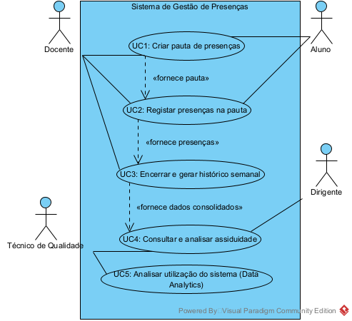
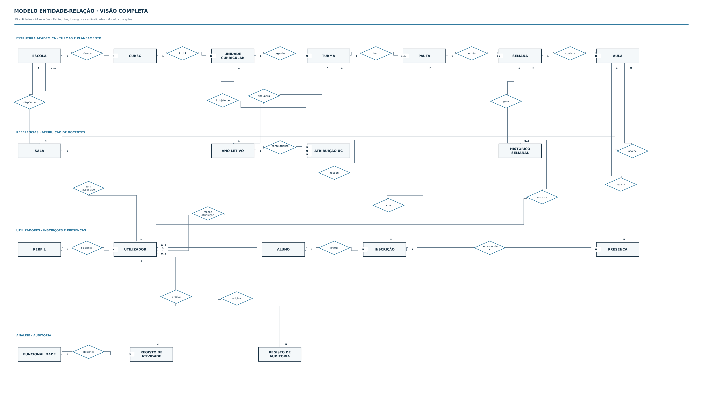
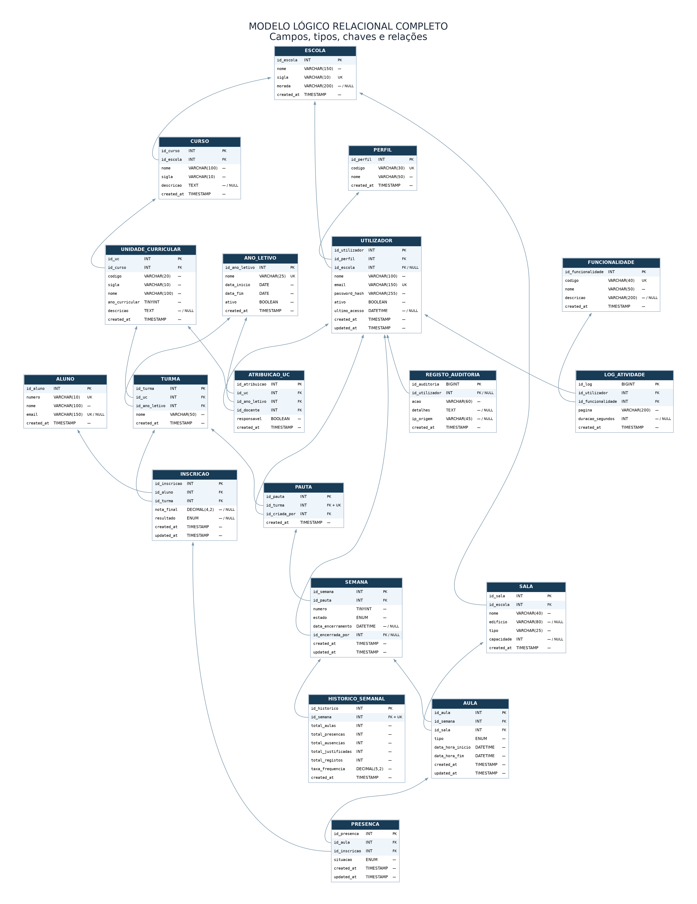
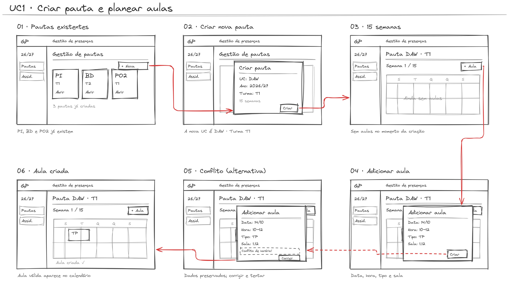
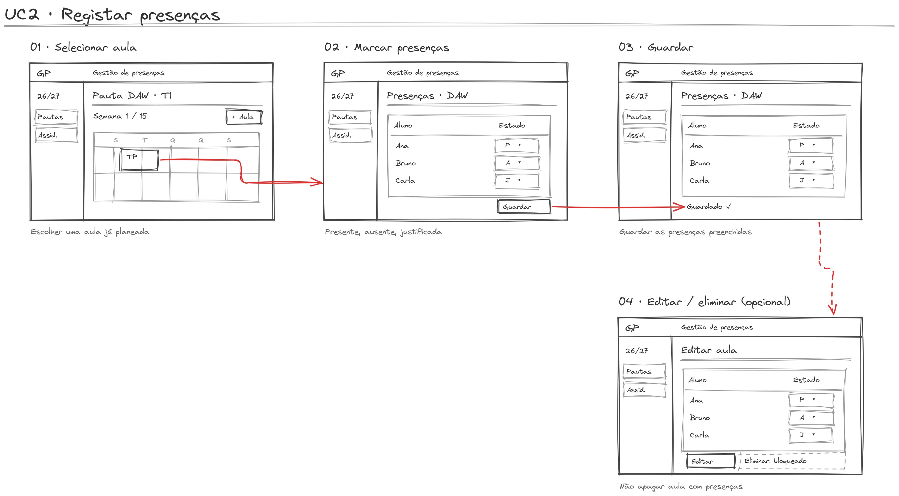
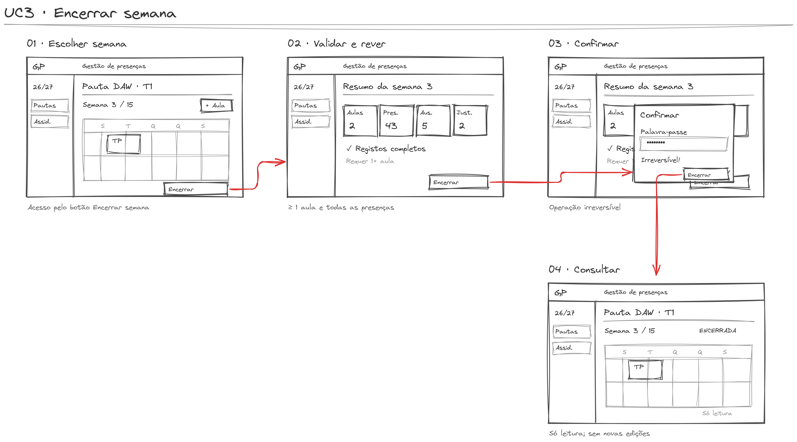
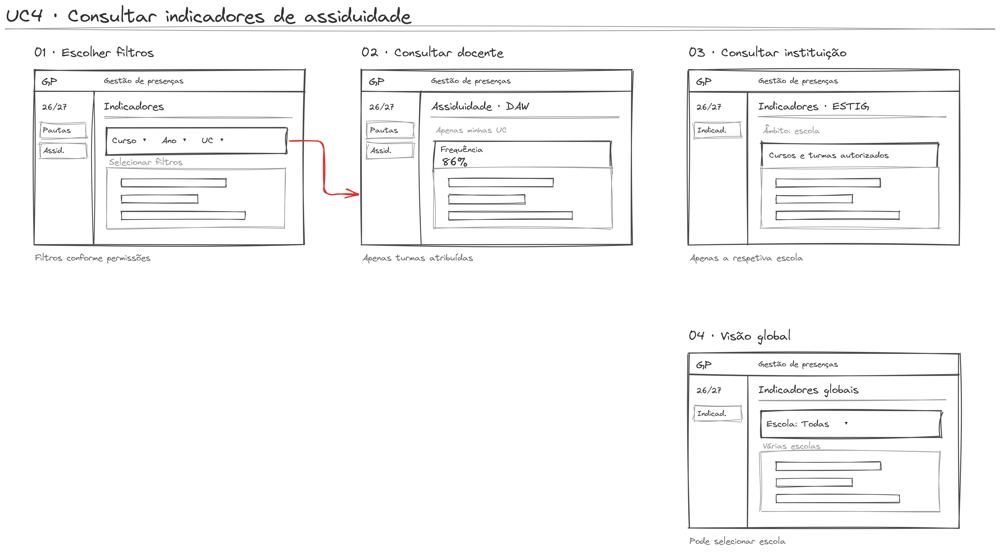
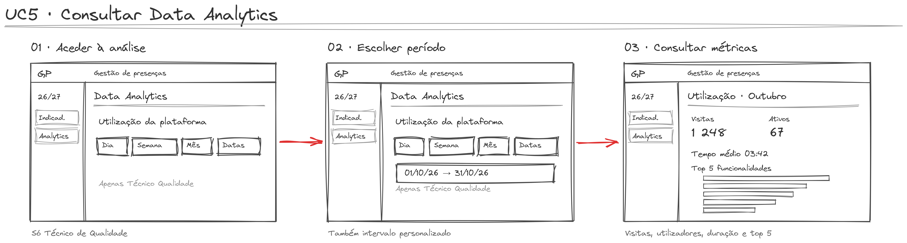

# Interfaces e storyboards — imagens finais

**Projeto:** Ferramenta de Gestão de Presenças em Contexto Letivo — DAW 2026/2027 

Os fluxos estão especificados em [02 — Casos de uso](02-casos-de-uso.md), e o modelo de dados em [03 — Base de dados](03-base-de-dados.md).

## Diagramas finais

### Diagrama UML dos cinco casos de uso

### Diagrama Entidade-Relação (E/R)]

### Modelo relacional completo

## Storyboards por caso de uso

### Storyboard UC1

### Storyboard UC2

### Storyboard UC3

### Storyboard UC4

### Storyboard UC5

## Wireframes finais por caso de uso

Cada imagem apresenta um ecrã ou estado do mesmo caso de uso.

### UC1 — Criação da pauta e planeamento das aulas

| Ecrã | Estado ou operação | Abrir imagem |
|---|---|---|
| 02 | Gestão de pautas | [Visualizar](../../prototypes/wireframes/uc1/uc1-02-gestao-de-pautas.png) |
| 03 | Criar pauta em modal | [Visualizar](../../prototypes/wireframes/uc1/uc1-03-criar-pauta-em-modal.png) |
| 04 | Calendário semanal | [Visualizar](../../prototypes/wireframes/uc1/uc1-04-calendario-semanal.png) |
| 05 | Criar aula — modal | [Visualizar](../../prototypes/wireframes/uc1/uc1-05-criar-aula-modal.png) |
| 06 | Conflito de horário no modal | [Visualizar](../../prototypes/wireframes/uc1/uc1-06-conflito-de-horario-no-modal.png) |
| 07 | Semana sem aulas | [Visualizar](../../prototypes/wireframes/uc1/uc1-07-semana-sem-aulas.png) |

### UC2 — Registo de presenças

| Ecrã | Estado ou operação | Abrir imagem |
|---|---|---|
| 01 | Selecionar aula no calendário | [Visualizar](../../prototypes/wireframes/uc2/uc2-01-selecionar-aula-no-calendario.jpg) |
| 02 | Registar presenças | [Visualizar](../../prototypes/wireframes/uc2/uc2-02-registar-presencas.jpg) |
| 03 | Presenças guardadas | [Visualizar](../../prototypes/wireframes/uc2/uc2-03-presencas-guardadas.jpg) |
| 04 | Editar aula — opcional | [Visualizar](../../prototypes/wireframes/uc2/uc2-04-editar-aula-opcional.jpg) |
| 05 | Eliminação bloqueada | [Visualizar](../../prototypes/wireframes/uc2/uc2-05-eliminacao-bloqueada.jpg) |

### UC3 — Encerramento e histórico semanal

| Ecrã | Estado ou operação | Abrir imagem |
|---|---|---|
| 01 | Selecionar semana | [Visualizar](../../prototypes/wireframes/uc3/uc3-01-selecionar-semana.jpg) |
| 02 | Resumo semanal | [Visualizar](../../prototypes/wireframes/uc3/uc3-02-resumo-semanal.jpg) |
| 03 | Confirmação por palavra-passe | [Visualizar](../../prototypes/wireframes/uc3/uc3-03-confirmacao-por-palavra-passe.jpg) |
| 04 | Histórico semanal | [Visualizar](../../prototypes/wireframes/uc3/uc3-04-historico-semanal.jpg) |
| 05 | Semana encerrada em leitura | [Visualizar](../../prototypes/wireframes/uc3/uc3-05-semana-encerrada-em-leitura.jpg) |

### UC4 — Indicadores de assiduidade

| Ecrã | Estado ou operação | Abrir imagem |
|---|---|---|
| 01 | Assiduidade do docente | [Visualizar](../../prototypes/wireframes/uc4/uc4-01-assiduidade-do-docente.jpg) |
| 02 | Indicadores do técnico | [Visualizar](../../prototypes/wireframes/uc4/uc4-02-indicadores-do-tecnico.jpg) |
| 03 | Indicadores do diretor | [Visualizar](../../prototypes/wireframes/uc4/uc4-03-indicadores-do-diretor.jpg) |
| 04 | Indicadores da Presidência | [Visualizar](../../prototypes/wireframes/uc4/uc4-04-indicadores-da-presidencia.jpg) |
| 05 | Assiduidade e sucesso académico | [Visualizar](../../prototypes/wireframes/uc4/uc4-05-assiduidade-e-sucesso-academico.jpg) |
| 06 | Consulta institucional dos registos | [Visualizar](../../prototypes/wireframes/uc4/uc4-06-consulta-institucional-dos-registos.jpg) |

### UC5 — Data Analytics — utilização da plataforma

| Ecrã | Estado ou operação | Abrir imagem |
|---|---|---|
| 01 | Utilização da plataforma | [Visualizar](../../prototypes/wireframes/uc5/uc5-01-utilizacao-da-plataforma.jpg) |
| 02 | Seleção de período | [Visualizar](../../prototypes/wireframes/uc5/uc5-02-selecao-de-periodo.jpg) |
| 03 | Consulta sem registos | [Visualizar](../../prototypes/wireframes/uc5/uc5-03-consulta-sem-registos.jpg) |

## Rastreabilidade e limites

- **UC1:** criação de pauta em modal, calendário, criação de aula, conflito de horário e semana sem aulas.
- **UC2:** selecionar aula, registar presenças, guardar, editar aula e impedir eliminação de aulas com assiduidade.
- **UC3:** selecionar semana, validar resumo, confirmar com palavra-passe, consultar histórico e estado só de leitura.
- **UC4:** consultas separadas por Docente, Técnico, Diretor e Presidência; relação assiduidade–sucesso e consulta institucional.
- **UC5:** o ecrã 01 contém resultados de utilização; o 02 representa um **período diferente com métricas distintas**; o 03 mostra o **estado sem registos**.

